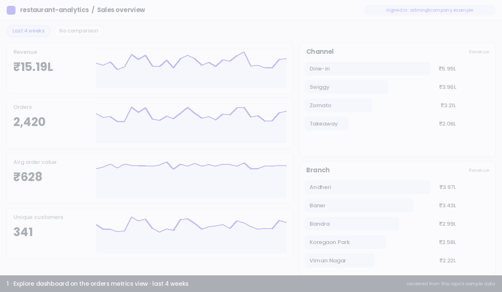
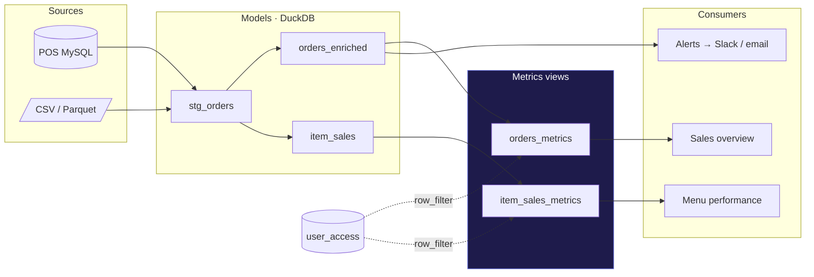
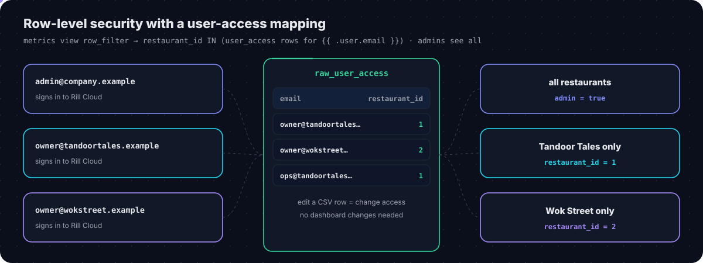

<div align="center">

# 🍽️ Rill Client Analytics Platform

**Client analytics on Rill + DuckDB: source pipelines → SQL models → metrics views (semantic layer) → explore dashboards, row-level security and alerts**




<sub>Rendered from this repo's own sample data and metrics definitions: comparison, leaderboard filter, time range, and row-level security for a client login.</sub>

</div>

> **About this repo.** It recreates the client analytics platform I built and ran on Rill at work: the same project structure, modeling patterns, security model, alerts and checks. The data is a **synthetic sample** (two fictional restaurant brands, 5 branches, ~7.5k bills, Aug–Oct 2026), so the project runs as-is with `rill start`. No company or client names or data are included.

---

## 📌 Contents

| | | | |
|---|---|---|---|
| 1 | [What I worked on](#-1-what-i-worked-on) | 8 | [Alerts](#-8-alerts) |
| 2 | [The problem it solves](#-2-the-problem-it-solves) | 9 | [Data quality checks](#-9-data-quality-checks) |
| 3 | [Architecture](#%EF%B8%8F-3-architecture) | 10 | [How I delivered each client](#-10-how-i-delivered-each-client) |
| 4 | [The pipeline, file by file](#-4-the-pipeline-file-by-file) | 11 | [Real-life use cases](#-11-real-life-use-cases) |
| 5 | [Metrics views: the semantic layer](#-5-metrics-views-the-semantic-layer) | 12 | [Glossary](#-12-glossary) |
| 6 | [Explore dashboards](#-6-explore-dashboards) | 13 | [Repository structure · run it](#%EF%B8%8F-13-repository-structure) |
| 7 | [Row-level security](#-7-row-level-security) | 14 | [Author](#-author) |

---

## 👨‍💻 1. What I worked on

| | |
|---|---|
| 🔁 **Migration** | Moved client reporting to **Rill** on **DuckDB**, with dashboards that load in seconds |
| 🏢 **Scale** | Owned end-to-end delivery for **50+ restaurant clients**, from requirements to production rollout |
| 🧱 **Pipelines & models** | Source pipelines from the **POS MySQL** database and SQL models that turn raw data into clean fact tables at a known grain |
| 📐 **Semantic layer** | **Metrics views** that define every KPI once (net revenue, orders, AOV, cancellations, delivery time, items vs modifiers) |
| 📊 **Dashboards** | **Explore** dashboards with time comparison, leaderboards and filters, plus **pivot** views for menu analysis |
| 🔐 **Security** | **Row-level security** so each client, and each user within a client, sees only their own restaurants |
| 🔔 **Alerts** | Alerts on client **targets** and on **data issues** such as duplicate order IDs, sent to **Slack** or email |
| ✅ **Data quality** | Reconciliation and sanity checks so dashboard numbers match the POS before every deploy |
| 🤖 **AI-assisted development** | Used **Claude Code** to speed up model and metrics-view development, data validation and report accuracy checks |

---

## 🎯 2. The problem it solves

| Before | After |
|---|---|
| Reports built by hand (SQL + Excel) for each client | **Self-serve dashboards** on governed metrics |
| The same KPI calculated differently in different reports | **One definition per KPI** in the metrics view |
| Owners waited for an analyst for simple questions | Owners **filter, compare and drill** themselves |
| One shared database made client access risky | **Row-level security** per user, enforced on every query |
| Data problems found by clients | **Alerts and checks** catch them first |
| Every client a new build | **Same template**, client-specific config |

---

## 🏗️ 3. Architecture




Rill is **BI as code**: every object is a YAML or SQL file in this repo. Rill reads the files, builds the tables in **DuckDB** in dependency order, and serves the dashboards. Changes are reviewed in Git like any other code.

---

## 🧩 4. The pipeline, file by file

<p align="center">
  
</p>

### Sources: land the raw data
No business logic here, so any number can be traced back to the source.

```yaml
# sources/raw_orders.yaml
type: model
connector: duckdb
materialize: true
sql: |
  SELECT *
  FROM read_csv('data/orders.csv', header = true, auto_detect = true)
```
<sub>In production this reads from the client's POS MySQL database on a refresh schedule.</sub>

### Models: clean, de-duplicate, set the grain

```sql
-- models/stg_orders.sql (excerpt)
SELECT
    order_id,
    TRIM(channel)                                              AS channel,
    CASE WHEN channel IN ('Swiggy','Zomato') THEN 'Delivery'
         ELSE 'In-store' END                                   AS channel_group,
    CAST(order_ts AS TIMESTAMP)                                AS order_ts,
    -- a 1 AM bill belongs to yesterday's business day
    CAST(CAST(order_ts AS TIMESTAMP) - INTERVAL 4 HOUR AS DATE) AS business_date,
    net_amount, discount, delivery_min
FROM raw_orders
QUALIFY ROW_NUMBER() OVER (PARTITION BY order_id ORDER BY order_ts DESC) = 1
```

| Model | One row = | What it adds |
|---|---|---|
| `stg_orders` | one bill | types, trimmed text, de-duplication, business date, hour |
| `orders_enriched` | one bill | branch, city, restaurant, late-delivery flag |
| `item_sales` | one line on a bill | product, category, **sold as item vs modifier**, line revenue |

> 💡 **Two fact tables on purpose.** Bills and bill lines are one-to-many. Summing a bill amount after joining to its lines counts each bill 2–4 times (the **fan-out trap**). One model per grain makes that impossible.

---

## 📐 5. Metrics views: the semantic layer


A **metrics view** turns a model into business language: **measures** (KPIs), **dimensions** (ways to slice), the **time column**, and **security**. Dashboards, alerts, exports and APIs all use it, so *Net revenue* means one thing everywhere.

```yaml
# metrics/orders_metrics.yaml (excerpt)
type: metrics_view
model: orders_enriched
timeseries: order_ts

dimensions:
  - name: channel
    column: channel
  - name: branch
    column: branch_name

measures:
  - name: revenue
    display_name: Revenue
    expression: SUM(CASE WHEN status = 'completed' THEN net_amount ELSE 0 END)
  - name: aov
    display_name: Avg order value
    expression: SUM(CASE WHEN status = 'completed' THEN net_amount ELSE 0 END)
                / NULLIF(COUNT(DISTINCT CASE WHEN status = 'completed' THEN order_id END), 0)
```

| Measures in this repo | Dimensions |
|---|---|
| Revenue · Orders · Avg order value · Unique customers · Discount · Cancellation rate · Avg delivery time · Late deliveries % | Restaurant · Branch · City · Channel · Channel group · Payment method · Status · Hour of day |
| Qty sold · **Qty as item** · **Qty as modifier** · Item revenue | Product · Category · Sold as · Channel |

**Why this matters:** without it, three analysts write three revenue formulas and get three numbers. Business rules (completed orders only, net of discounts) live **inside** the measure, so no dashboard can forget them.

| Building block | Meaning | Here |
|---|---|---|
| **Dimensions** | group / filter by | channel, branch, hour |
| **Measures** | what you calculate | revenue, AOV, cancel rate |
| **Time** | time column and grains | `order_ts` → hour / day / week / month |
| **Relationships** | joins, done in models | bills → branches → restaurants |
| **Security** | who sees which rows | `row_filter` (section 7) |

---

## 📊 6. Explore dashboards

```yaml
# dashboards/orders_explore.yaml
type: explore
metrics_view: orders_metrics
dimensions: '*'
measures: [revenue, orders, aov, customers, discount, cancel_rate, avg_delivery_min, late_delivery_rate]
defaults:
  time_range: P4W
  comparison_mode: time
```

What a user can do (shown in the GIF at the top):

| Action | What happens |
|---|---|
| Pick a **time range** (last 7 days, 4 weeks, custom) | every measure and leaderboard re-queries DuckDB |
| Turn on **comparison** | each number shows its change vs the previous period; charts show the previous period dashed |
| **Click a leaderboard row** (e.g. Swiggy) | becomes a filter for the whole dashboard |
| **Pivot** | rows × columns analysis, e.g. category × sold as item / modifier |
| **Export** | CSV / Excel of what's on screen |


---

## 🔐 7. Row-level security

<p align="center">
  
</p>

Access is controlled by a small mapping source, [`data/user_access.csv`](data/user_access.csv), and one `row_filter` on each metrics view:

```yaml
security:
  access: true
  row_filter: >
    {{ .user.admin }} OR
    restaurant_id IN (SELECT restaurant_id FROM raw_user_access WHERE email = '{{ .user.email }}')
```

| Signed in as | Sees |
|---|---|
| a project / org **admin** | all restaurants |
| `owner@tandoortales.example` | Tandoor Tales only |
| `owner@wokstreet.example` | Wok Street only |

- **Onboarding or offboarding a client user = editing one CSV row.** No dashboard changes.
- The filter is applied by Rill on **every query** (dashboards, pivots, exports, APIs), so it can't be bypassed from the UI.
- Fields can also be hidden per user with `include` / `exclude` rules (e.g. cost columns).

📖 [Rill docs: metrics view security](https://docs.rilldata.com/developers/build/metrics-view/security)

---

## 🔔 8. Alerts

<p align="center">
  
</p>

A Rill alert is a YAML file with a **cron schedule**, a **query**, and **where to notify**. It fires when the query **returns rows**.

```yaml
# alerts/duplicate_orders.yaml
type: alert
display_name: Duplicate order IDs detected
refresh:
  cron: "0 * * * *"
data:
  sql: |
    SELECT order_id, branch_id, CAST(order_ts AS DATE) AS order_date, COUNT(*) AS copies
    FROM raw_orders
    WHERE order_id IS NOT NULL
    GROUP BY order_id, branch_id, CAST(order_ts AS DATE)
    HAVING COUNT(*) > 1
notify:
  slack:
    channels:
      - '#data-alerts'
```

| Alert | Checks | Notifies |
|---|---|---|
| [`duplicate_orders.yaml`](alerts/duplicate_orders.yaml) | the same order landing twice from the POS | Slack |
| [`data_freshness.yaml`](alerts/data_freshness.yaml) | no new orders for over a day (pipeline stopped) | Slack |
| [`target_achieved.yaml`](alerts/target_achieved.yaml) | a branch crossed its monthly target ([`branch_targets.csv`](data/branch_targets.csv)) | owner by email |

📖 [Rill docs: alerts](https://docs.rilldata.com/reference/project-files/alerts)

---

## ✅ 9. Data quality checks

<p align="center">
  
</p>

Run before every deploy. Expected result: **0 rows** (or all zeros). The outputs shown are the real results on this repo's sample data.

| Check | Catches |
|---|---|
| [`01_duplicate_orders.sql`](checks/01_duplicate_orders.sql) | the same bill counted twice |
| [`02_revenue_reconciliation.sql`](checks/02_revenue_reconciliation.sql) | dashboard revenue ≠ source revenue on any day |
| [`03_orphan_keys.sql`](checks/03_orphan_keys.sql) | bills without a branch, lines without a product or bill |
| [`04_freshness_and_sanity.sql`](checks/04_freshness_and_sanity.sql) | stale data, negative bills, impossible delivery times, future dates |

**Claude Code in this workflow:** drafting model and metrics-view YAML from a requirement, generating reconciliation queries per client, and explaining mismatches (fan-out joins, missing status filters, time-zone and business-day errors) before clients saw them.

---

## 🔁 10. How I delivered each client

<p align="center">
  
</p>

| Step | Output in this repo |
|---|---|
| 1 · Requirements: KPIs, definitions (*does revenue include tax?*), branches, users, targets | KPI sheet |
| 2 · Connect the POS MySQL database | `sources/*.yaml` |
| 3 · Model: clean, de-duplicate, business-day rule | `models/*.sql` |
| 4 · Metrics view: measures, dimensions, security | `metrics/*.yaml` |
| 5 · Dashboards with sensible defaults (last 4 weeks, comparison on) | `dashboards/*.yaml` |
| 6 · Validate against the POS | `checks/*.sql` |
| 7 · Alerts: duplicates, freshness, targets | `alerts/*.yaml` |
| 8 · Map users, walkthrough, rollout | `data/user_access.csv` |

Every client used the **same layered template**, so a new client was mostly **configuration, not new code**. That's how 50+ clients stayed maintainable.

---

## 🌍 11. Real-life use cases

| Who | Question | Where |
|---|---|---|
| 👨‍🍳 Owner | "This week vs last week?" | Sales overview, comparison on |
| 🏪 Branch manager | "Why is my branch below target?" | filter branch → channel leaderboard → hour of day |
| 🛵 Delivery lead | "Are aggregator orders late?" | avg delivery time, late deliveries % by channel |
| 📋 Menu team | "What sells as an item vs as an add-on?" | Menu performance pivot |
| 💸 Finance | "Where are discounts eating margin?" | discount by branch and channel, export |
| 🧾 Data team | "Did anything break overnight?" | duplicate and freshness alerts in Slack |
| 🎯 Owner | "Tell me when we hit the target" | target-achieved email |

---

## 📖 12. Glossary

| Term | Meaning |
|---|---|
| **Rill** | open-source BI-as-code tool: sources, models, metrics views, dashboards and alerts as YAML/SQL, served on DuckDB |
| **DuckDB** | in-process columnar **OLAP** database, fast for aggregations on millions of rows |
| **OLTP vs OLAP** | the POS MySQL handles many small writes; DuckDB handles big analytical reads |
| **Source** | raw data landed as-is |
| **Model** | SQL that produces a clean table; **materialize** stores the result |
| **Grain** | what one row represents (one bill, one bill line) |
| **Metrics view** | Rill's semantic layer: measures + dimensions + time + security |
| **Explore dashboard** | interactive dashboard with time comparison, leaderboards and filters |
| **Row filter** | SQL condition Rill adds to every query for the signed-in user |
| **Alert** | scheduled query that notifies when it returns rows |
| **Business date** | the trading day a bill belongs to (late-night bills roll back) |

---

## 🗂️ 13. Repository structure

```text
rill-client-analytics-platform/
├── rill.yaml                     # project config (DuckDB, dashboard defaults)
├── data/                         # synthetic sample data
│   ├── orders.csv · order_items.csv · branches.csv · products.csv
│   ├── user_access.csv           # email → restaurant (row-level security)
│   └── branch_targets.csv        # monthly targets (target alert)
├── sources/                      # land raw data (one file per table)
├── models/                       # stg_orders · orders_enriched · item_sales
├── metrics/                      # orders_metrics · item_sales_metrics (+ security)
├── dashboards/                   # orders_explore · menu_explore
├── alerts/                       # duplicate_orders · data_freshness · target_achieved
├── checks/                       # pre-deploy data-quality SQL
└── docs/images/                  # GIF + animated diagrams
```

### ▶️ Run it locally

```bash
curl https://rill.sh | sh                     # install Rill (macOS / Linux)
git clone https://github.com/suyogpatil395/rill-client-analytics-platform.git
cd rill-client-analytics-platform
rill start                                    # opens http://localhost:9009
```

Locally you're an admin, so you see all data. Deploy to Rill Cloud (`rill deploy`) and add users to see row-level security and alerts in action.

**Sample data:** ~7,475 bills and ~19,000 bill lines for two fictional brands (*Tandoor Tales*, *Wok Street*) across 5 branches in Pune and Mumbai, 1 Aug – 24 Oct 2026: dine-in, takeaway, Swiggy and Zomato orders, cancellations, discounts and delivery times.

### 🛠️ Tech stack

`MySQL (POS)` · `DuckDB` · `SQL (CTEs, window functions, QUALIFY)` · `Rill: metrics views, explore, pivot, alerts, security` · `Slack / email alerts` · `Claude Code` · `Git`

---

## 🔗 Related

- [Sigma Computing Analytics Platform](https://github.com/suyogpatil395/sigma-computing-analytics-platform): the Sigma side of the same client work
- [Analytics Studio](https://github.com/suyogpatil395/analytics-studio): AI report builder on a semantic layer
- [Agentic Analytics Skills](https://github.com/suyogpatil395/agentic-analytics-skills): MCP + skills on governed metrics

---

## 👤 Author

<div align="center">

**Suyog Patil**
*Data Engineer · Analytics & BI*

[](https://www.linkedin.com/in/suyog-patil-0089241b2/)
[](https://github.com/suyogpatil395)

⭐ If this helped you understand semantic layers or Rill, consider starring the repo.

</div>
