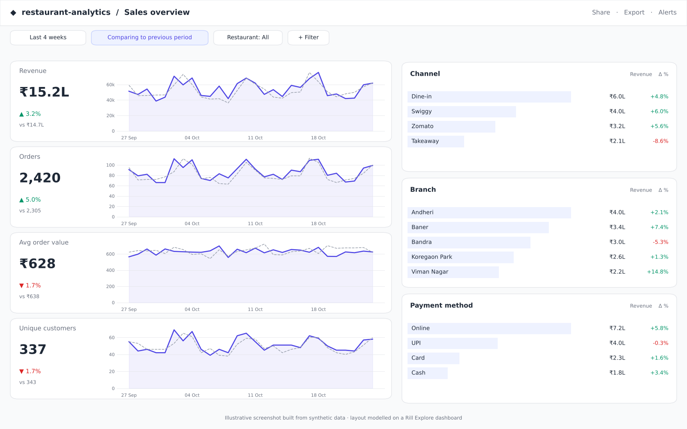
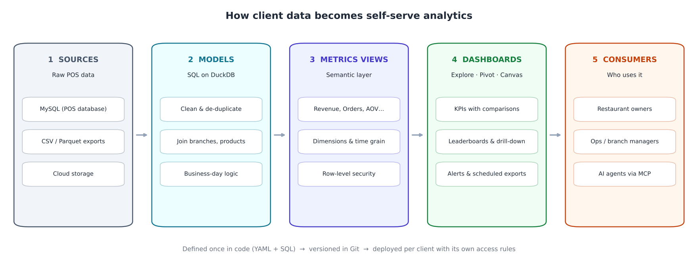
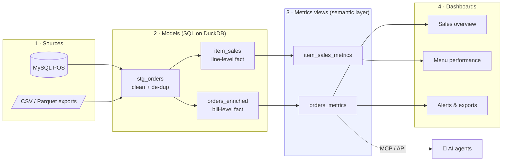
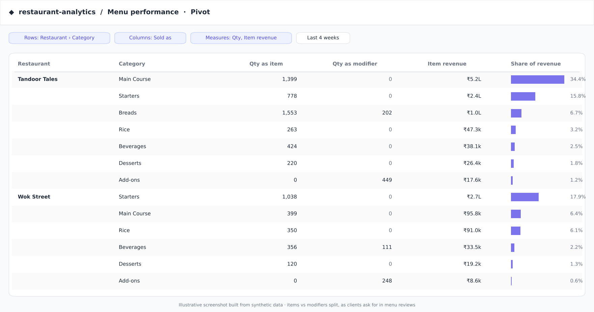
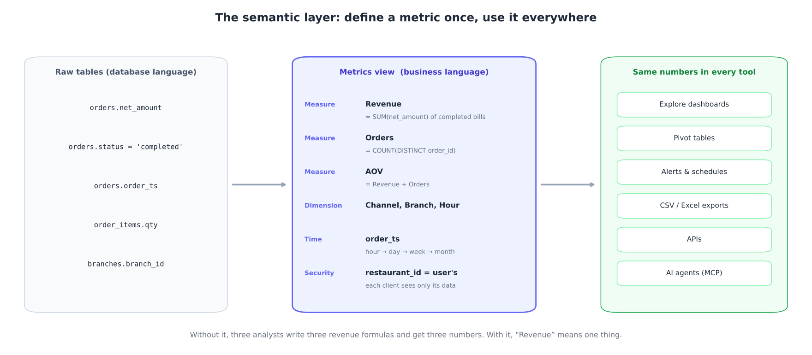
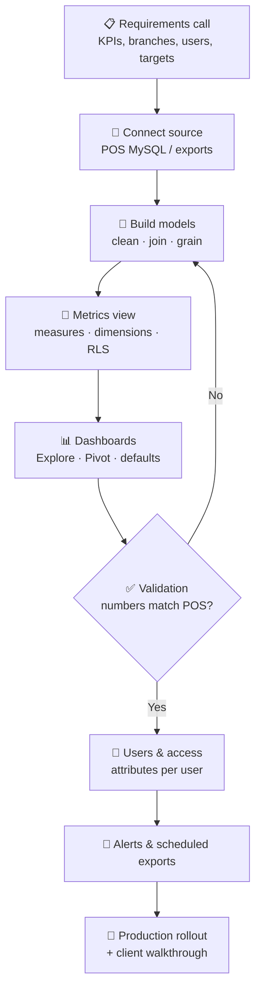

<div align="center">

# 🍽️ Rill Client Analytics Platform

**End-to-end client analytics on Rill + DuckDB: source pipelines → SQL models → a governed semantic layer → self-serve dashboards**




</div>

> **About this repo.** It recreates the analytics platform I build and run for restaurant clients at work, using a **fully synthetic dataset** (two made-up restaurant brands, 5 branches, ~7.5k bills, Aug–Oct 2026). **No company or client names, data or screenshots are included.** The YAML and SQL follow the same patterns I use in production, so the project runs as-is with `rill start`.

---

## 📌 Table of contents

1. [What I worked on](#-what-i-worked-on)
2. [The problem this solves](#-the-problem-this-solves)
3. [Architecture at a glance](#-architecture-at-a-glance)
4. [The four layers, explained](#-the-four-layers-explained)
5. [The semantic layer, with examples](#-the-semantic-layer-with-examples)
6. [How I deliver a client, step by step](#-how-i-deliver-a-client-step-by-step)
7. [Data validation with Claude Code](#-data-validation-with-claude-code)
8. [Real-life use cases](#-real-life-use-cases)
9. [Glossary](#-glossary)
10. [Repository structure](#-repository-structure)
11. [Run it locally](#-run-it-locally)
12. [Author](#-author)

---

## 👨‍💻 What I worked on

| | |
|---|---|
| 🏢 **Scale** | Owned end-to-end delivery for **50+ restaurant clients**, from the first requirements call to production rollout |
| 🧱 **Data modeling** | Designed source pipelines and SQL models on **DuckDB** that turn raw POS data (MySQL) into clean, analysis-ready fact tables |
| 📐 **Semantic layer** | Built **metrics views** that define every KPI once (revenue, orders, AOV, cancellations, delivery time…) so all clients see consistent numbers |
| 📊 **Dashboards** | Shipped Explore and Pivot dashboards with period comparisons, leaderboards and drill-down, which load in seconds |
| 🔐 **Security** | Implemented **row-level security** so each client, and each user within a client, sees only their own restaurants |
| 🔔 **Automation** | Set up alerts on client targets and scheduled exports, replacing manual daily reports |
| 🤖 **AI-assisted development** | Used **Claude Code** to speed up model and metrics development, run data validation and check report accuracy across client projects |
| ✅ **Data quality** | Wrote reconciliation and sanity checks so dashboard numbers always match the POS ([see `checks/`](checks)) |

---

## 🎯 The problem this solves

Restaurant owners have plenty of data in their POS but very little insight. Before this platform:

- ❌ Every report was **built by hand** (SQL + Excel) for each client, every day
- ❌ The same KPI was **calculated differently** in different reports, so numbers didn't match
- ❌ Owners **waited for an analyst** to answer simple questions like “how did Swiggy do last weekend?”
- ❌ Sharing one database across clients made **data access** risky

After:

- ✅ One **semantic layer** defines each metric once; every dashboard, export and alert uses it
- ✅ **Self-serve dashboards**: owners filter, compare and drill down on their own
- ✅ **Sub-second queries** on DuckDB, even across months of bill-level data
- ✅ **Row-level security** built into the metrics layer, not bolted on per report
- ✅ Everything is **code** (YAML + SQL) in Git: reviewable, reusable across clients, easy to roll back

---

## 🏗️ Architecture at a glance





---

## 🧩 The four layers, explained

Rill is **“BI as code”**: every object is a YAML or SQL file. Rill reads the files, builds the tables in DuckDB and serves the dashboards. There are four layers, each with one clear job.

### 1️⃣ Sources: land the raw data

**What:** a connection to where the data lives (MySQL, S3/GCS, local files) plus a query that copies it into DuckDB.
**Rule:** *no business logic here.* Land the data exactly as it is, so you can always trace a number back to the source.

```yaml
# sources/raw_orders.yaml
type: model
connector: duckdb
materialize: true
sql: |
  SELECT *
  FROM read_csv('data/orders.csv', header = true, auto_detect = true)
```

> In production this reads from the client's MySQL POS on a refresh schedule, incrementally where possible.

### 2️⃣ Models: clean, join and shape

**What:** SQL files that transform raw tables into **clean fact tables** at a known **grain**.
**Why:** dashboards should never deal with duplicates, wrong types or messy text. Fix it once here.

```sql
-- models/stg_orders.sql (excerpt)
SELECT
    order_id,
    TRIM(channel)                                              AS channel,
    CASE WHEN channel IN ('Swiggy','Zomato') THEN 'Delivery'
         ELSE 'In-store' END                                   AS channel_group,
    CAST(order_ts AS TIMESTAMP)                                AS order_ts,
    -- restaurants trade past midnight: a 1 AM bill belongs to yesterday's business day
    CAST(CAST(order_ts AS TIMESTAMP) - INTERVAL 4 HOUR AS DATE) AS business_date,
    net_amount, discount, delivery_min
FROM raw_orders
QUALIFY ROW_NUMBER() OVER (PARTITION BY order_id ORDER BY order_ts DESC) = 1  -- de-duplicate
```

| Model | Grain (one row = …) | Purpose |
|---|---|---|
| `stg_orders` | one bill | typed, trimmed, de-duplicated, business-day logic |
| `orders_enriched` | one bill | + branch, city, restaurant, late-delivery flag |
| `item_sales` | one line on a bill | product, category, **sold as item vs modifier**, line revenue |

> 💡 **Why two fact tables?** Bills and bill lines are one-to-many. If you sum a bill-level amount after joining to its lines, every bill is counted 2–4 times (the **fan-out trap**). Keeping each grain in its own model makes that bug impossible.

### 3️⃣ Metrics views: the semantic layer

**What:** a YAML file that turns a model into **business language**: *measures* (KPIs), *dimensions* (ways to slice), the *time column* and *security rules*.
**Why:** this is the single source of truth. Dashboards, alerts, exports, APIs and AI agents all ask the metrics view, never the raw table. ([Deep dive below ↓](#-the-semantic-layer-with-examples))

```yaml
# metrics/orders_metrics.yaml (excerpt)
type: metrics_view
model: orders_enriched
timeseries: order_ts

dimensions:
  - name: channel
    column: channel
  - name: branch
    column: branch_name

measures:
  - name: revenue
    display_name: Revenue
    expression: SUM(CASE WHEN status = 'completed' THEN net_amount ELSE 0 END)
  - name: aov
    display_name: Avg order value
    expression: SUM(CASE WHEN status = 'completed' THEN net_amount ELSE 0 END)
                / NULLIF(COUNT(DISTINCT CASE WHEN status = 'completed' THEN order_id END), 0)

security:
  access: true
  row_filter: "restaurant_id = {{ .user.restaurant_id }}"   # each client sees only its data
```

### 4️⃣ Dashboards: self-serve exploration

**What:** **Explore** dashboards (KPI trends + leaderboards + filters), **Pivot** tables and **Canvas** layouts built on a metrics view.
**Why:** owners answer their own questions: filter to a branch, compare with last month, drill into a channel, export to Excel.

```yaml
# dashboards/orders_explore.yaml
type: explore
metrics_view: orders_metrics
dimensions: '*'
measures: [revenue, orders, aov, customers, discount, cancel_rate, avg_delivery_min, late_delivery_rate]
defaults:
  time_range: P4W
  comparison_mode: time
```



---

## 📐 The semantic layer, with examples



### What it is, in one line

> A semantic layer is a **translation layer between raw tables and the people (or tools, or AI) asking questions.** Each business term is defined **once** in SQL; everything else reuses that definition.

🍽️ **Analogy:** it's the **menu** of a restaurant. The kitchen (database) has raw ingredients and recipes. The customer orders “Paneer Tikka” from the menu and gets the same dish every time, without knowing the recipe.

### The problem without it

| Analyst | Their “revenue” formula | Result |
|---|---|---|
| A | `SUM(net_amount)` | includes cancelled bills ❌ |
| B | `SUM(net_amount - discount)` | discount subtracted twice ❌ |
| C | `SUM(net_amount) WHERE status = 'completed'` | correct ✅ |

Three dashboards, three numbers, and the client stops trusting all of them. **With a metrics view, “Revenue” has exactly one definition.**

### The five building blocks: remember **D-M-T-R-S**

> “**D**on't **M**ake **T**he **R**eports **S**eparately”

| Block | Meaning | Example in this repo |
|---|---|---|
| **D**imensions | what you group / filter by | Channel, Branch, City, Payment method, Hour |
| **M**easures | what you calculate | Revenue, Orders, AOV, Cancellation rate, Late deliveries % |
| **T**ime | the time column and grains | `order_ts` → hour / day / week / month, with period comparison |
| **R**elationships | how tables join (done in models) | bills → branches → restaurants; lines → products |
| **S**ecurity | who sees which rows | `restaurant_id = {{ .user.restaurant_id }}` |

### Example questions → one metrics view

| Business question | Measure × Dimension × Time |
|---|---|
| “Which channel grew most vs last month?” | `revenue` × `channel` × last month vs previous |
| “Is Zomato delivering late?” | `late_delivery_rate`, `avg_delivery_min` × `channel` |
| “Which branch has the most cancellations?” | `cancel_rate` × `branch` |
| “When is the kitchen busiest?” | `orders` × `order_hour` |
| “Are we giving away too much discount?” | `discount` ÷ `revenue` × `branch` |
| “How many naans are sold as add-ons?” | `qty_as_modifier` × `product` (item_sales_metrics) |

---

## 🔁 How I deliver a client, step by step



| Step | What happens | Output |
|---|---|---|
| 1. Requirements | Agree on KPIs, definitions (e.g. *does revenue include tax?*), branches, users, targets | KPI sheet |
| 2. Source | Connect the client's POS database; land raw tables | `sources/*.yaml` |
| 3. Models | Clean, de-duplicate, join, apply business-day rules | `models/*.sql` |
| 4. Metrics view | Define measures, dimensions, time grain and row-level security | `metrics/*.yaml` |
| 5. Dashboards | Explore / Pivot with sensible defaults (last 4 weeks, compare to previous period) | `dashboards/*.yaml` |
| 6. Validation | Reconcile dashboard totals with the POS day by day | `checks/*.sql` |
| 7. Access | Create users with attributes (`restaurant_id`) so RLS applies | user config |
| 8. Automation | Alerts on targets (e.g. daily revenue below plan), scheduled Excel exports | alerts / reports |
| 9. Rollout | Walk the client through the dashboards; collect feedback | live project |

Because every client follows the same layered pattern, a new client is mostly **configuration, not new code**. That's how one person can deliver 50+.

---

## 🤖 Data validation with Claude Code

I used **Claude Code** as a pair-programmer across client projects:

- ⚡ **Faster development**: drafting SQL models and metrics-view YAML from a requirement description, then reviewing and adjusting
- 🔍 **Validation**: generating and running reconciliation queries (dashboard vs source, per day / branch / channel) and explaining mismatches
- 🧪 **Report accuracy checks**: spotting fan-out joins, missing status filters, time-zone and business-day errors before clients do
- 📝 **Documentation**: keeping metric definitions and change notes up to date

The checks in this repo are the kind I run before every rollout:

| Check | What it catches | Expected |
|---|---|---|
| [`01_duplicate_orders.sql`](checks/01_duplicate_orders.sql) | the same bill counted twice | 0 rows |
| [`02_revenue_reconciliation.sql`](checks/02_revenue_reconciliation.sql) | dashboard revenue ≠ source revenue on any day | 0 rows |
| [`03_orphan_keys.sql`](checks/03_orphan_keys.sql) | bills without a branch, lines without a product | all 0 |
| [`04_freshness_and_sanity.sql`](checks/04_freshness_and_sanity.sql) | stale data, negative bills, impossible delivery times | latest = today, rest 0 |

---

## 🌍 Real-life use cases

| Who | Question | Where they find it |
|---|---|---|
| 👨‍🍳 **Restaurant owner** | “How did we do this week vs last week?” | Sales overview → Revenue, Orders, AOV with comparison |
| 🏪 **Branch manager** | “Why is my branch below target?” | Filter Branch → Channel leaderboard → drill into hour of day |
| 🛵 **Delivery / ops lead** | “Are aggregator orders late? Which one is worse?” | `avg_delivery_min`, `late_delivery_rate` by channel |
| 📋 **Menu team** | “Which dishes sell, and which are only add-ons?” | Menu performance → Pivot: qty as item vs as modifier |
| 💸 **Finance** | “Where are discounts eating margin?” | `discount` by branch and channel; scheduled Excel export |
| 🧑‍🍳 **Kitchen planning** | “When should we add staff?” | Orders by hour of day × weekday |
| 🚨 **Everyone** | “Tell me when something is wrong” | Alerts: daily revenue below target, cancellation spike |

---

## 📖 Glossary

| Term | Meaning |
|---|---|
| **Rill** | Open-source “BI as code” tool: define sources, models, metrics and dashboards in YAML/SQL; it runs them on DuckDB |
| **DuckDB** | An in-process **OLAP** database: columnar and vectorised, very fast for aggregations on millions of rows |
| **OLTP vs OLAP** | OLTP (the POS MySQL) handles many small writes; OLAP (DuckDB) handles big analytical reads |
| **Source** | Where raw data comes from, landed as-is |
| **Model** | A SQL transformation that produces a clean table |
| **Grain** | What one row represents (one bill, one bill line). Always define it |
| **Fact / dimension** | Facts are events with numbers (bills); dimensions describe them (branch, product) |
| **Materialize** | Store a model's result as a table instead of recomputing it on every query |
| **Metrics view** | Rill's semantic layer: measures + dimensions + time + security on top of a model |
| **Measure** | An aggregate KPI expression, e.g. `SUM(net_amount)` |
| **Dimension** | A column to group or filter by, e.g. channel |
| **Explore dashboard** | Rill's interactive dashboard: KPI trends, comparisons, leaderboards, filters |
| **Row-level security (RLS)** | A filter applied automatically per user so they only see permitted rows |
| **Business date** | The trading day a bill belongs to (late-night bills roll back to the previous day) |
| **MCP** | Model Context Protocol, which lets AI agents query metrics views safely through the semantic layer |

---

## 🗂️ Repository structure

```text
rill-client-analytics-platform/
├── rill.yaml                     # project config (DuckDB, dashboard defaults)
├── data/                         # synthetic POS export (CSV)
│   ├── orders.csv                # one row per bill
│   ├── order_items.csv           # one row per bill line
│   ├── branches.csv
│   └── products.csv
├── sources/                      # 1 · land raw data
│   ├── raw_orders.yaml
│   ├── raw_order_items.yaml
│   ├── raw_branches.yaml
│   └── raw_products.yaml
├── models/                       # 2 · clean, join, shape
│   ├── stg_orders.sql
│   ├── orders_enriched.sql
│   └── item_sales.sql
├── metrics/                      # 3 · semantic layer
│   ├── orders_metrics.yaml
│   └── item_sales_metrics.yaml
├── dashboards/                   # 4 · self-serve dashboards
│   ├── orders_explore.yaml
│   └── menu_explore.yaml
├── checks/                       # data-quality & reconciliation SQL
└── docs/images/                  # diagrams and illustrative screenshots
```

---

## ▶️ Run it locally

```bash
# 1. Install Rill (macOS / Linux)
curl https://rill.sh | sh

# 2. Clone and start
git clone https://github.com/suyogpatil395/rill-client-analytics-platform.git
cd rill-client-analytics-platform
rill start
```

Rill opens at `http://localhost:9009`. Open **Sales overview** or **Menu performance**.

> Row-level security uses a `restaurant_id` user attribute. Locally you're an admin, so you see all data. In Rill Cloud, set the attribute per user to restrict access.

**Dataset:** ~7,475 bills and ~19,000 bill lines for two fictional brands (*Tandoor Tales*, *Wok Street*) across 5 branches in Pune and Mumbai, 1 Aug – 24 Oct 2026, including dine-in, takeaway, Swiggy and Zomato orders, cancellations, discounts and delivery times.

---

## 🛠️ Tech stack

| Layer | Tools |
|---|---|
| Source | MySQL (POS), CSV / Parquet |
| Engine | DuckDB |
| Modeling | SQL (CTEs, window functions, QUALIFY) |
| Semantic layer & BI | Rill: metrics views, Explore, Pivot, alerts |
| Security | Row-level security with user attributes |
| AI-assisted development | Claude Code |
| Version control | Git / GitHub |

---

## 👤 Author

<div align="center">

**Suyog Patil**
*Data Engineer · Analytics & BI*

[](https://www.linkedin.com/in/suyog-patil-0089241b2/)
[](https://github.com/suyogpatil395)

⭐ If this helped you understand semantic layers or Rill, consider starring the repo.

</div>
